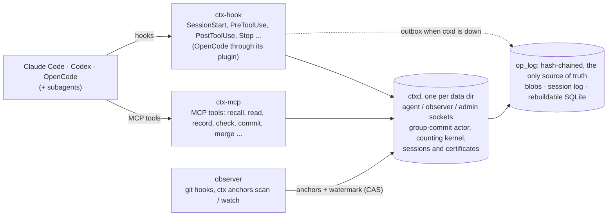

# ContextDB

[](https://github.com/zangjiucheng/ContextDB/actions/workflows/ci.yml)
[](https://zangjiucheng.github.io/ContextDB/)
[](rust-toolchain.toml)
[](LICENSE)

**A context database with invalidation proofs, shared by multiple AI coding agents.**

When several agents (Claude Code, Codex, OpenCode and their subagents) work in the same repository at once, the decisions, conventions and plans they rely on keep changing. ContextDB stores that context, and the dependencies between items, as an AND/OR justification DAG. When an upstream item is superseded, retracted, or the code it refers to changes, everything downstream is marked **precisely** STALE or PENDING, while conclusions that still have other support are left alone. Before an agent writes a file or runs a command, it checks a certificate that the context it read is still valid.

- **Specification**: [`SPEC.md`](SPEC.md) (v1.9.2, the only normative document; written mainly in Chinese with English systems terminology)
- **Documentation site**: <https://zangjiucheng.github.io/ContextDB/>
- **Status**: P0–P9 have passed their gates; see [Phases and status](#phases-and-status)
- **Harnesses**: Claude Code, Codex CLI and OpenCode 2.0, through MCP tools and hooks

## Why

Three agents work in parallel. A adopts decision `D1 = MongoDB`; B writes a schema plan `D2` based on it; C writes a deployment plan `D3` based on it. Then someone changes `D1` to PostgreSQL.

A memory system that only updates the "latest fact" cannot stop B and C from carrying on with their MongoDB-based plans. ContextDB answers:

- **What is adopted now?** (CURRENT)
- **Which downstream items lost their support, and which still have alternative support?** (IMPACT / WHY / WHY_NOT)
- **Which only need a semantic review (PENDING) instead of being declared invalid?**
- **Before an agent acts, is the context it read still current?** (certificate + action gate)
- **When code that a decision refers to changes, what happens to the conclusions built on it?** (code anchors)

None of the 18 open-source agent-memory projects examined at the source level has dependency-driven **transitive** invalidation, AND/OR alternative support, certified reads checked before an action, or code as a versioned premise in the same propagation graph (SPEC §1.3). ContextDB does not claim to invent these ideas: truth maintenance, counting-based view maintenance and pre-action validation all have prior art. Its claim is to **combine them correctly** in one kernel, measurably.

## Core concepts

| Concept | Meaning |
|---|---|
| **logical / revision** | A record (decision, plan, convention, evidence, code anchor) is a logical; every change creates an immutable revision, and a logical's head moves only by compare-and-swap |
| **justification** | A rule "these premises together support this conclusion". A conclusion can have several rules (OR), each needing all its premises (AND); losing one support keeps a conclusion that has another |
| **Four edge kinds** | `Pin`: depends on one exact revision, STALE once it is replaced; `Cur`: depends on the current revision, STALE whenever the head moves; `Sem`: semantic dependency, PENDING until re-validated against a new revision; `Ref`: reference only, never propagates; a record may carry only `Ref` deps, and then it holds only through `adopt_as_base`. A `Summary` can be depended on only through `Sem` or `Ref` |
| **States** | `CERTIFIED` (structurally and semantically valid), `STALE` (lost support, with a reason), `PENDING` (awaiting semantic review or observation catch-up), `CONFLICTED`, `UNAVAILABLE` |
| **certificate** | The set of items and revisions an agent read. Checked before an action: still valid, re-certifiable, or a list of the reads that are now out of date |
| **code anchor** | A repository file as a first-class record; its revision is the Git blob OID of the raw worktree bytes. When the file changes, dependent decisions become STALE or PENDING according to their edge kind |

The full semantics (SD1–SD19, the kind admission matrix, STALE reason precedence) are in SPEC §2; [`docs/SEMANTICS.md`](docs/SEMANTICS.md) maps every clause to its tests.

## Architecture

[docs/ARCHITECTURE.md](docs/ARCHITECTURE.md) has diagrams of the processes and channels, the crates, a write inside `ctxd`, the data directory, the kernel, hook gating across the three harnesses, and code anchors.



- **The op_log is the only source of truth**: all kernel state is replayed from it; SQLite holds only rebuildable projections. A commit is published and acknowledged only after its frame is written and synced.
- **Single-writer daemon**: one commit actor does group commit; readers get epoch-pinned snapshots and never see a half-written transaction.
- **Two oracles**: an independent InputModel and Jacobi / Kahn evaluators check the incremental kernel transaction by transaction (`paranoid` builds and property tests).

The crates and every phase's features are described in the [reference](docs/REFERENCE.md); the `ctx ui` viewer in [Getting started](docs/GETTING_STARTED.md#viewing-the-context-ctx-ui).

## Quick start

```sh
# 1. Install ctx, ctxd, ctx-mcp and ctx-hook (release builds for macOS arm64 / x86_64, Linux x86_64 / arm64)
curl -fsSL https://raw.githubusercontent.com/zangjiucheng/ContextDB/main/install.sh | bash
#    Installs into ~/.local/bin after checking the SHA-256 against checksums.txt.
#    Options: ... | bash -s -- --version vX.Y.Z --dir DIR --setup
#    Uses an authenticated gh when present; or clone and run bash install.sh.
#    From source (needs Rust 1.95.0): scripts/install.sh, into ~/.cargo/bin

# 2. Connect a repository in one step
cd /path/to/repo
ctx setup                          # Claude Code and Codex by default; --harness claude|codex|opencode for one, all for the three
```

Then approve the project MCP server the next time Claude Code starts, trust the new hooks with `/hooks` in Codex, and restart OpenCode in the project. Agents read what they rely on with `ctx_recall` / `ctx_read` and record decisions with `ctx_record`; `ctx ui .contextdb/db` opens a read-only viewer at <http://127.0.0.1:7787/>.

What `ctx setup` changes, upgrading, uninstalling and multi-user mode: [Getting started](docs/GETTING_STARTED.md).

## Phases and status

Every phase must pass its Verification Gate (G0 spec, G1 build, G2 goldens, G3 oracle / properties / mutation, G4 robustness, G5 performance, G6 scenario / real use, G7 regression, G8 docs, plus an independent review) before the next one starts (SPEC §4).

| Phase | Scope | Status |
|---|---|---|
| P0 | Formal contract and oracles | ✅ passed |
| P1 | Incremental counting kernel | ✅ passed |
| P2 | Durability and recovery | ✅ passed |
| P3 | Daemon, MCP and certified reads | ✅ passed |
| P4 | Hooks and action gating | ✅ passed (dogfood closed at 11.8 days by owner decision; enforce recommended for file edits only) |
| P5a | File-level code anchors | ✅ passed |
| P5b | Symbol-level code anchors | ✅ passed |
| P6 | Versioned transactions, branches and WHAT_IF | ✅ passed |
| P7 | Semantic validation and conflicts | ✅ passed |
| P8 | Retrieval, packing and git mirroring | ✅ passed |
| P9 | Principals, permissions and security (hard isolation, crypto-shred) | ✅ passed (G6 two-user run skipped by owner decision) |
| P10 | Mixed eager / lazy maintenance and scale | planned |
| P11 | Recursive support and replication (research) | planned |

Evidence for every layer is in [`docs/IMPLEMENTATION_STATUS.md`](docs/IMPLEMENTATION_STATUS.md) and [`docs/gates/`](docs/gates/).

## Limits and non-goals

- **Version consistency is not semantic truth**: ContextDB proves "usable under the declared dependency revisions and validation rules"; it does not judge whether natural-language content is correct.
- **The trust boundary is cooperative for the store owner's uid**: an agent that can run a shell as the same OS user can uninstall hooks or connect to the admin socket directly. Isolation between OS users, multi-principal permissions and crypto-shred are P9's multi-user mode ([reference](docs/REFERENCE.md#multi-user-mode-egress-and-shred-p9)).
- **Not supported yet**: cyclic dependencies (cyclic writes are refused; research in P11); negation, default logic, non-monotonic rules; valid-time / bitemporal queries (only transaction time is modelled); cross-machine replication.
- **TOCTOU**: there is still a window between the pre-action check and the actual write; Bash side effects are found only afterwards, by drift.

## Built on

ContextDB combines known techniques in one kernel; it does not claim to invent them. The main sources, cited in [SPEC.md](SPEC.md) §1.3 and §9:

[](https://doi.org/10.1016/0004-3702(79)90008-0)
[](https://doi.org/10.1016/0004-3702(86)90080-9)
[](https://doi.org/10.1145/170036.170066)
[](https://arxiv.org/abs/1711.03987)
[](https://doi.org/10.1016/j.artint.2019.04.002)
[](https://doi.org/10.1145/1187436.1210590)
[](https://www.cidrdb.org/cidr2013/Papers/CIDR13_Paper111.pdf)
[](https://doi.org/10.1007/s00778-025-00922-y)

Agent-memory work it is compared with:

[](https://arxiv.org/abs/2605.26252)
[](https://arxiv.org/abs/2607.23929)
[](https://arxiv.org/abs/2610.05732)
[](https://arxiv.org/abs/2609.03340)
[](https://arxiv.org/abs/2610.04838)

The full list, with what each one contributes, is in SPEC.md's references and the [research archive](docs/research/).

## Development

`bash scripts/check.sh` runs the same checks as CI (fmt, Clippy, all tests, loom model, dependency boundaries, licenses). Heavier verification and the gate process: [docs/DEVELOPMENT.md](docs/DEVELOPMENT.md).

## Documentation

| Path | Contents |
|---|---|
| [`docs/GETTING_STARTED.md`](docs/GETTING_STARTED.md) | Install, `ctx setup` in detail, upgrade and uninstall, releases, the `ctx ui` viewer |
| [`docs/REFERENCE.md`](docs/REFERENCE.md) | Crates, and what each phase added: commands, configuration, limits |
| [`docs/DEVELOPMENT.md`](docs/DEVELOPMENT.md) | Building, `check.sh`, heavier verification, the gate process |
| [`SPEC.md`](SPEC.md) | Normative specification: semantics, architecture, verification, phase plan, interfaces, test catalogue, threat model (mainly Chinese) |
| [`docs/ARCHITECTURE.md`](docs/ARCHITECTURE.md) | Architecture diagrams: processes, crates, writes, data directory, kernel, hooks, anchors |
| [`docs/adr/`](docs/adr/) | Design decision records (ADR 0001–0017) |
| [`docs/gates/`](docs/gates/) | Gate evidence, review records and benchmark results per phase |
| [`docs/IMPLEMENTATION_STATUS.md`](docs/IMPLEMENTATION_STATUS.md) | Current implementation and gate status |
| [`docs/SEMANTICS.md`](docs/SEMANTICS.md) | Mapping from semantic clauses to tests |
| [`CHANGELOG.md`](CHANGELOG.md) | Change log |
| [`docs/research/`](docs/research/) | Research archive (not normative) |

License: Apache-2.0, see [`LICENSE`](LICENSE).
