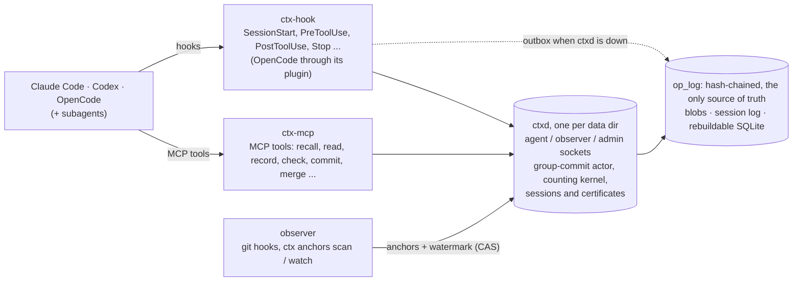

# ContextDB

**English** | [简体中文](README.zh-CN.md)

**A context database with invalidation proofs, shared by multiple AI coding agents.**

When several agents (Claude Code, Codex, OpenCode and their subagents) work in the same repository at once, the decisions, conventions and plans they rely on keep changing. ContextDB stores that context, and the dependencies between items, as an AND/OR justification DAG. When an upstream item is superseded, retracted, or the code it refers to changes, everything downstream is marked **precisely** STALE or PENDING, while conclusions that still have other support are left alone. Before an agent writes a file or runs a command, it checks a certificate that the context it read is still valid.

- **Specification**: [`SPEC.md`](SPEC.md) (v1.6.11, the only normative document; written mainly in Chinese with English systems terminology)
- **Architecture**: [`docs/ARCHITECTURE.md`](docs/ARCHITECTURE.md) (diagrams)
- **Status**: P0–P3 have passed their gates; P4–P6 are implemented and pass every layer, and their phase gates wait on P4's real-use dogfood report (no earlier than 2026-11-04; see [Phases and status](#phases-and-status))
- **Harnesses**: Claude Code, Codex CLI and OpenCode 2.0, through MCP tools and hooks
- **Stack and license**: Rust 1.95.0, Apache-2.0

## Why

Three agents work in parallel. A adopts decision `D1 = MongoDB`; B writes a schema plan `D2` based on it; C writes a deployment plan `D3` based on it. Then someone changes `D1` to PostgreSQL.

A memory system that only updates the "latest fact" cannot stop B and C from carrying on with their MongoDB-based plans. ContextDB answers:

- **What is adopted now?** (CURRENT)
- **Which downstream items lost their support, and which still have alternative support?** (IMPACT / WHY / WHY_NOT)
- **Which only need a semantic review (PENDING) instead of being declared invalid?**
- **Before an agent acts, is the context it read still current?** (certificate + action gate)
- **When code that a decision refers to changes, what happens to the conclusions built on it?** (code anchors)

None of the 18 open-source agent-memory projects examined at the source level has dependency-driven **transitive** invalidation, AND/OR alternative support, certified reads checked before an action, or code as a versioned premise in the same propagation graph (SPEC §1.3). ContextDB does not claim to invent these ideas: truth maintenance, counting-based view maintenance and pre-action validation all have prior art. Its claim is to **combine them correctly** in one kernel, measurably.

## Core concepts

| Concept | Meaning |
|---|---|
| **logical / revision** | A record (decision, plan, convention, evidence, code anchor) is a logical; every change creates an immutable revision, and a logical's head moves only by compare-and-swap |
| **justification** | A rule "these premises together support this conclusion". A conclusion can have several rules (OR), each needing all its premises (AND); losing one support keeps a conclusion that has another |
| **Four edge kinds** | `Pin`: depends on one exact revision, STALE once it is replaced; `Cur`: depends on the current revision, STALE whenever the head moves; `Sem`: semantic dependency, PENDING until re-validated against a new revision; `Ref`: reference only, never propagates; a record may carry only `Ref` deps, and then it holds only through `adopt_as_base`. A `Summary` can be depended on only through `Sem` or `Ref` |
| **States** | `CERTIFIED` (structurally and semantically valid), `STALE` (lost support, with a reason), `PENDING` (awaiting semantic review or observation catch-up), `CONFLICTED`, `UNAVAILABLE` |
| **certificate** | The set of items and revisions an agent read. Checked before an action: still valid, re-certifiable, or a list of the reads that are now out of date |
| **code anchor** | A repository file as a first-class record; its revision is the Git blob OID of the raw worktree bytes. When the file changes, dependent decisions become STALE or PENDING according to their edge kind |

The full semantics (SD1–SD19, the kind admission matrix, STALE reason precedence) are in SPEC §2; [`docs/SEMANTICS.md`](docs/SEMANTICS.md) maps every clause to its tests.

## Architecture

[docs/ARCHITECTURE.md](docs/ARCHITECTURE.md) has diagrams of the processes and channels, the crates, a write inside `ctxd`, the data directory, the kernel, hook gating across the three harnesses, and code anchors.



- **The op_log is the only source of truth**: all kernel state is replayed from it; SQLite holds only rebuildable projections. A commit is published and acknowledged only after its frame is written and synced.
- **Single-writer daemon**: one commit actor does group commit; readers get epoch-pinned snapshots and never see a half-written transaction.
- **Two oracles**: an independent InputModel and Jacobi / Kahn evaluators check the incremental kernel transaction by transaction (`paranoid` builds and property tests).

| crate | Role |
|---|---|
| `contextdb-model` | Dependency-free transaction vocabulary: IDs, the 14 Ops, wire encoding |
| `contextdb-core` | Incremental counting kernel: support / witness / three-layer certification, CURRENT, WHY, IMPACT, DIFF, certificates |
| `contextdb-oracle` | Independent reference implementation, for verification only |
| `contextdb-store` | op_log, blobs, snapshots, recovery, SQLite projections, session log |
| `contextdb-daemon` | `ctxd`: single-writer daemon, snapshot publication, local IPC, sessions and gating |
| `contextdb-proto` | IPC protocol, lease discovery, blocking client, gate predicate, hook outbox |
| `contextdb-mcp` | `ctx-mcp`: MCP stdio client |
| `contextdb-hooks` | `ctx-hook`: Claude Code / Codex / OpenCode hook adapters |
| `contextdb-anchors` | File-anchor observer: Git OID capture, classification, commit |
| `contextdb-symbols` | Symbol anchors: tree-sitter extraction and the normaliser (observer side only; `ctxd` never links it) |
| `contextdb-cli` | `ctx`: operations, checks, anchors, gating, setup and hook installation |
| `contextdb-testkit` / `-harness` / `-workload` / `-bench` | Goldens, property tests, replay, workload generation and benchmarks |

Separate workspaces: `crates/contextdb-dd` (research baseline, outside the product dependency graph) and `fuzz/`. `ctx ui` serves a local, read-only context graph viewer: one branch at a time (selector when there are several), `ref` edges, open Conflict artifacts, code anchors by path and symbol with their decoded descriptors, structured WHY / WHY-NOT, and the live status from `ctxd` next to the replayed one.


*`ctx ui` on this repository's own dogfood data: decisions and plans with their `pin` / `cur` dependencies; the panel shows a plan's body, the rules it depends on, its dependents and its L0/L1/L2 certification.*

## Quick start

```sh
# 1. Install ctx, ctxd, ctx-mcp and ctx-hook (release builds for macOS arm64 / x86_64, Linux x86_64 / arm64)
curl -fsSL https://raw.githubusercontent.com/zangjiucheng/ContextDB/main/install.sh | bash
#    Installs into ~/.local/bin after checking the SHA-256 against checksums.txt.
#    Options: ... | bash -s -- --version vX.Y.Z --dir DIR --setup
#    Uses an authenticated gh when present; or clone and run bash install.sh.
#    From source (needs Rust 1.95.0): scripts/install.sh, into ~/.cargo/bin

# 2. Connect a repository in one step
cd /path/to/repo
ctx setup                          # Claude Code and Codex by default; --harness claude|codex|opencode for one, all for the three
```

`ctx setup`:

- creates the data directory (default `<repo>/.contextdb/db`) and adds it to `.git/info/exclude`;
- starts `ctxd` through a per-repository user service (launchd on macOS, systemd `--user` on Linux), so it starts at login and restarts after a crash. A `ctxd` that is already running is left alone. If it was started by hand, `ctx shutdown <dir>` followed by `ctx setup` hands it to the service. Without a usable service manager (an SSH session, CI), `ctxd` is started detached and setup says so. `--no-service` starts it detached on purpose; `--no-start` starts nothing. If a `ctxd` speaking another protocol version already serves the directory, setup reports an error and changes nothing;
- registers the `contextdb` MCP server per project: `.mcp.json` for Claude Code, `.codex/config.toml` for Codex, `opencode.json` for OpenCode, keeping all other configuration;
- installs the hooks for each harness (`.claude/settings.local.json`, `.codex/hooks.json`, the OpenCode plugin `.opencode/plugins/contextdb/`) with the default gating mode `warn`;
- keeps the files it writes out of Git, since they hold machine-specific paths: untracked ones are added to `.git/info/exclude`, and a tracked one (e.g. a team `.mcp.json`) gets a warning. Commit `.contextdb/gating.toml` and `.contextdb/policy.toml` to share gating and policy.

Then follow the prompts: approve the project MCP server the next time Claude Code starts, open `/hooks` in Codex to trust the new hooks, and restart OpenCode in the project so it loads the plugin. Re-running `ctx setup` is idempotent. `ctx service status <dir>` shows the service and `ctxd`; `ctx service uninstall <dir>` removes the service (after a deliberate `ctx shutdown`, the service does not restart `ctxd`).

Once connected, agents read the decisions they rely on with `ctx_recall` / `ctx_read` (certified mode) and record decisions and plans with `ctx_record` (with `deps`; a refused dep says which one and what to send instead). When PreToolUse finds that context the agent read is out of date, it adds an explanation without blocking; switch to `enforce` once the false-alarm rate is low enough (see the P4 section below). Other common commands:

```sh
ctx anchors add .contextdb/db . src/main.rs docs/design.md   # register key files as code anchors
ctx status .contextdb/db                                      # record and session counts
ctx ui .contextdb/db                                          # read-only context graph viewer at http://127.0.0.1:7787/
```

**Upgrade**: run the install command again, then `ctx service restart <dir>` (or `ctx shutdown <dir>` followed by `ctx setup`). `ctxd`, `ctx-mcp` and `ctx-hook` must come from the same build; a protocol mismatch is rejected explicitly. **Uninstall**: in each repository run `ctx service uninstall <dir>` and `ctx hooks uninstall --harness … --project …`, then `bash install.sh --uninstall`.

**Releases**: pushing a `v*` tag runs `.github/workflows/release.yml`, which builds `contextdb-<os>-<arch>.tar.gz` for four platforms plus `checksums.txt` and publishes a release. When hosted Actions are unavailable, `scripts/release.sh <tag>` builds both macOS architectures locally and Linux x86_64 on the remote host, then publishes with `gh`.

## Phases and status

Every phase must pass its Verification Gate (G0 spec, G1 build, G2 goldens, G3 oracle / properties / mutation, G4 robustness, G5 performance, G6 scenario / real use, G7 regression, G8 docs, plus an independent review) before the next one starts (SPEC §4).

| Phase | Scope | Status |
|---|---|---|
| P0 | Formal contract and oracles | ✅ passed |
| P1 | Incremental counting kernel | ✅ passed |
| P2 | Durability and recovery | ✅ passed |
| P3 | Daemon, MCP and certified reads | ✅ passed |
| P4 | Hooks and action gating | 🟡 implemented; every layer passes except the ≥ 2-week real-use dogfood (report no earlier than 2026-11-04) |
| P5a | File-level code anchors | 🟡 implemented; every layer passes, waiting only on P4 |
| P5b | Symbol-level code anchors | 🟡 implemented; every layer and the independent review pass (walk 4), waiting only on P5a/P4 |
| P6 | Versioned transactions, branches and WHAT_IF | 🟡 implemented; G0–G5, G7, G8 and the independent review pass; the phase gate waits on P5b, P5a and P4 |
| P7 | Semantic validation and conflicts | planned |
| P8 | Retrieval, packing and git mirroring | planned |
| P9 | Principals, permissions and security (hard isolation, crypto-shred) | planned |
| P10 | Mixed eager / lazy maintenance and scale | planned |
| P11 | Recursive support and replication (research) | planned |

Evidence for every layer is in [`docs/IMPLEMENTATION_STATUS.md`](docs/IMPLEMENTATION_STATUS.md) and [`docs/gates/`](docs/gates/).

## Reference

### Kernel (P0–P1)

The Rust API provides `Db<Counting, NoStats>` / `Db<FullRecompute, CommitStats>`, atomic transactions, CURRENT, WHY / WHY_NOT, Reachable / Exact IMPACT, cross-epoch DIFF and deterministic digests. Counting maintains L0 incrementally and L1/L2 as counters (ADR 0008 §7); `paranoid` builds cross-check every commit against the independent oracle.

- Immutable revisions and logical heads, with mandatory CAS
- Forward-only, acyclic AND/OR justifications; exact incremental set support / unsat / witness; Pearce–Kelly dynamic topological order with a NaiveTopo reference
- Structural support and semantic PENDING are independent
- **Pin-strict**: a `Pin` to a replaced revision (except Evidence) is STALE. Use Evidence or `Ref` for historical references, and `Rebind` or `Sem` to follow new revisions
- Transactions publish atomically; intermediate states are invisible to readers
- Certificate issue and validation: L2 witness closure, the `since_epoch` window in strict mode, op_log link checks and re-certification (`ValidRecertified`)

```sh
cargo run --locked -p contextdb-core --example basic
```

The example builds a source → derived rule, retracts the source, and asserts that both nodes flip and that derived becomes STALE.

### Durability (P2)

- **Source of truth**: an own append-only segmented log in `<dir>/log/`; one frame per committed batch, linked by a blake3 hash chain. SQLite only holds rebuildable projections (`diff_log`, `head_history`, `base_history`).
- **When a commit is acknowledged**: only after its frame is written and synced. macOS uses F_FULLFSYNC by default (`StdDisk { full_sync: true }`); the fullfsync-off mode exists only for measurement. A failed sync or write is fail-stop: the store is poisoned and can only be recovered by reopening in a new process.
- **After a crash**: recovery to the acknowledged prefix (I5). An incomplete last frame is truncated and reported in the open report (`--strict-tail` refuses to open instead); damage to an earlier frame refuses to open and can only be repaired explicitly with `ctx doctor --truncate-before`, which first lists the epochs and client_txn_ids that would be lost.
- **Idempotency**: a retry with the same `client_txn_id` returns the original result; `txn_status` returns `Committed{epoch}` or `NotCommitted`. A poisoned store refuses all reads and `txn_status`; the outcome of an in-flight transaction is known only after restart.
- **Operator tools**: `ctx` never creates a store; a mistyped path gives `NotAStore`. `doctor --truncate-before` and `migrate` hold the same directory lock. An interrupted migration makes open refuse (`MigrationIncomplete`); running `ctx migrate` again completes it.
- **Not supported**: erasure before P9 (blobs are never deleted); no signed heads, so the hash chain detects damage but not a wholesale rewrite.

```sh
ctx replay <dir>        # open, replay and print the open report
ctx doctor <dir>        # hash chain, full oracle check, blob check; --rebuild rebuilds projections
ctx snapshot <dir>      # write an input-layer snapshot for faster cold starts
ctx migrate <dir>       # migrate an older op_log format (keeps a backup)
ctx export <dir>        # export as EventLog v0 JSONL
```

### Daemon and MCP (P3)

- **`ctxd <dir>`**: one daemon per data directory, the only writer of the op_log. A second instance is refused by the directory lock and lease (T37). Network and virtual file systems are refused by default; `--allow-fs <name>` allows one explicitly.
- **Commits**: a single commit actor batches write requests into a group commit with one op_log sync per group; every reply waits for that sync. Payloads are appended to self-verifying blob packs, with ordered syncs so they are durable before the frames that reference them (ADR 0008 §17).
- **Reads**: readers get an epoch-pinned snapshot and never see a half-written group (I4). Snapshots alternate between two replicas, and a reclaimed replica is reused only when no reader holds it (checked with loom).
- **Three sockets**: `<dir>/run/agent.sock`, `observer.sock`, `admin.sock` (in a temporary directory if the path would be too long), mode 0600 with a peer-uid check. The socket determines the channel; request parameters cannot forge an identity. Controlled semantic validation (`ctx validate`, which an authorised maintenance agent may run) and `shutdown` are admin-only; raw batches are not accepted from agents.
- **Trust boundary**: P3 promises only a cooperative boundary. A malicious agent that can run a shell as the same OS user can still connect to the observer/admin sockets; hard isolation comes with principals and ACLs in P9.
- **Sessions**: sessions, read ledgers and certificates are written to a separate session log (`<dir>/sessions/`), grouped and hash-chained like the op_log, so sessions survive a daemon restart. Read events are durable within 100 ms; `SessionStart`, `CertIssued` and `SessionEnd` sync immediately.
- **Timeouts and overload**: a full write queue returns `Busy`. A request over 30 s returns `Timeout`; a timed-out write may still commit, and `ctx_txn_status` with its `client_txn_id` tells you whether it did.

**MCP**: `ctx-mcp <dir>` serves JSON-RPC 2.0 over stdio (one message per line) and finds the agent socket through `<dir>/ctxd.lease`.

| Tool | Purpose |
|---|---|
| `ctx_recall` | Search by key / body (FTS5); certified mode returns only CERTIFIED items, with handles usable as deps (`<12 hex>.<idx>`) |
| `ctx_read` | Read one record; certified mode fails unless the current head is CERTIFIED |
| `ctx_record` | Create (`create_only` + `key`) or revise by CAS (`expected_head = key@rev`). Each dep is a handle or `key@rev` with a kind: `cur`, `pin`, `sem` (the only premise kind a Summary accepts) or `ref` (a reference that never changes status). Deps that are all `ref` support nothing, so such a record holds only with `adopt_as_base` |
| `ctx_supersede` | Replace a head; `carry_rules=copy` copies only the old head's own justifications, and downstream rules are never rebound automatically |
| `ctx_why` / `ctx_why_not` / `ctx_impact` | Explain why something holds or not, and list what depends on it |
| `ctx_check` | Check this session's certificate (this agent's view): verdict, diffs, and the reads that changed since the last acknowledgement (`context_update`, peeked not consumed); optionally with `action{tool, paths, command}` |
| `ctx_txn_status` | Look up `Committed{epoch}` or `NotCommitted` by `client_txn_id` |
| `ctx_commit` / `ctx_what_if` | Several ops atomically on the session's branch (optionally only while the session certificate is valid), or a dry run of them (P6) |
| `ctx_branch` / `ctx_merge` | Create, list or archive branches; merge one into another (P6) |

P3 does not offer `ctx_validate` to agents.

**Operator commands** (through the admin socket while `ctxd` runs; offline commands are refused with `Locked` while it runs):

```sh
ctxd <dir> [--allow-fs <name>]   # start the daemon
ctx status <dir>                 # revision / logical / session counts
ctx why|why-not|impact <dir> <key[@rev]>
ctx diff <dir> <from> <to>
ctx validate <dir> <key@rev> verified|rejected [--yes]
                                 # controlled validation: shows the current semantic vectors first;
                                 # automation may pass --yes, still admin-only with a curvec CAS
ctx shutdown <dir>
```

### Hooks and action gating (P4)

`ctx-hook <claude|codex|opencode> <event>` is the hook command for Claude Code (2.1.306), Codex CLI (0.163.0) and OpenCode (2.0.32, through its plugin): it reads one hook event from stdin, prints at most one JSON object, and always exits 0 (ADR 0010). OpenCode 2.0 has plugins instead of hook commands: `ctx hooks install --harness opencode` writes a plugin that calls `ctx-hook opencode <event>` with the same stdin and maps its answer back. A deny fails the tool call, a warning follows the tool's output, and the briefing and per-turn context go into the system prompt. OpenCode's MCP calls carry their session id, so no claim is needed, and a subagent's child session is its own ContextDB session (ADR 0014).

- **Install**: `ctx hooks install --harness claude|codex|opencode --project <repo> --dir <data dir>` merges the hooks into `.claude/settings.local.json` (personal and untracked) or `.codex/hooks.json`, keeping any other hooks, or writes the OpenCode plugin to `.opencode/plugins/contextdb/`. Reinstalling changes nothing, and `uninstall` removes only ContextDB's entries. **Codex runs new hooks only after you trust them** (open `/hooks` in Codex, or accept the startup review), and again after every change. `ctx setup` does this for you.
- **Session binding**: each hook event binds to a ctxd session by the harness's `session_id`. MCP calls bind by the tool-call id the harness puts in `_meta`: Codex sends `sessionId` / `threadId` directly, OpenCode sends `ai.opencode/sessionID`; for Claude Code, the PreToolUse hook claims the `tool_use_id` first. A call without an id uses `ctx-mcp`'s own session and is marked `unclaimed`; nothing is guessed from content.
- **Subagents**: a Claude Code or Codex subagent shares its root's session with a per-agent view: it inherits the root's reads, its reads enter the root's view, and the root's own reads of a logical take precedence. An OpenCode subagent runs in its own child session, which is a separate ContextDB session (more warnings, never a false allow).
- **PreToolUse**: Edit / Write / MultiEdit / NotebookEdit / Bash (Claude), `apply_patch` / Bash (Codex) and `edit` / `write` / `patch` / `shell` (OpenCode) check the session certificate before running. `warn` mode adds context explaining which reads changed; `enforce` mode denies on Invalid / Conflicted / Denied / Ambiguous with a reason of at most 480 bytes; an allow prints nothing (it never bypasses the harness's own permission prompts). A session with no certified reads (`Empty`) never counts as passing; it warns once per session and agent, and every occurrence is recorded. A check that does not get an answer in time says `ctxd did not answer within N ms`.
- **Gating configuration**: `.contextdb/gating.toml` (`mode = off|warn|enforce`, `shell_mode`, `on_unavailable = open|closed`, `timeout_ms`, `[[rule]]` per tool / path glob) takes effect after `ctx gating apply <dir>`. Defaults: `warn`, fail-open, 500 ms. If the daemon is unreachable, times out or the input cannot be parsed, `open` only notes it and `closed` denies; outside a ContextDB repository nothing happens.
- **context_update**: UserPromptSubmit appends the reads that changed since the last acknowledgement to the new prompt as `<context_update epoch=…>`, without rewriting the existing prefix (keeps the prompt cache); they are acknowledged with the next prompt, and lost output is sent again.
- **Outbox and drift**: PostToolUse writes facts to a local outbox first (`<data dir>/outbox/`, self-verifying records, a monotonic seq per stream), then delivers them; the daemon applies them idempotently by `(stream, seq)`, and `ctxd` delivers leftover streams at start and every 30 s. Stop / SubagentStop / PreCompact compare Git's actual changes with the recorded edits and report "files changed without a record" (such as Bash side effects) as a `systemMessage`. Drift is reported, never gated, and is an upper bound: changes by people or by agents without hooks also appear.
- **Policy**: `.contextdb/policy.toml` (e.g. `version = 1`, `require_deps = ["Decision", "Plan"]`) is committed with `ctx policy apply <dir>` through the admin socket; it is enforced inside kernel transactions, so no channel can bypass it, regardless of hooks or `git --no-verify`.
- **What is recorded**: action facts (including full Bash commands) go to the session log for drift and dogfood reports; a secret in a command is recorded too.
- **Remaining window (TOCTOU)**: there is still a window between the PreToolUse check and the actual write; it narrows the risk but does not remove it. Bash side effects cannot be resolved to paths before execution and are only found afterwards by drift. The trust boundary is cooperative: an agent can uninstall hooks or connect to the admin socket directly (hard isolation in P9).

```sh
ctx check <dir> --harness claude --key <session_id> [--strict] [--dry-run --action-tool edit --action-path src/a.rs]
                                 # exit codes: 0 allow (warn is 0 too unless --fail-on-warn), 1 deny, 2 error, 3 daemon unreachable
ctx check <dir> --all            # exit 1 if any head is STALE / CONFLICTED (optional, not installed by default)
ctx hooks flush <dir>            # deliver all pending outbox facts now
ctx gate-report P4 <dir> [--out docs/gates/p4-dogfood.md]
ctx dogfood review <dir>         # agents review warn/deny decisions and sampled allows for the false-deny rate
```

**Upgrade note**: P4 raised the IPC protocol to version 2; a P3 `ctx-mcp` gets a `ProtocolVersion` error and recovers when the harness restarts it. P4 adds session-log events that P3 binaries cannot open (no downgrade); P3 session logs replay unchanged under P4.

### File-level code anchors (P5a)

Register repository files as `CodeAnchor` records, and decisions and plans can depend on them like on any other record; when a file changes, dependents become STALE or PENDING according to their edge kind (ADR 0011).

- **Identity**: an anchor revision is the Git blob OID of the **raw worktree bytes** (as `git hash-object --no-filters`, SHA-1 and SHA-256 repositories), without clean / EOL filters. Identical content reuses the same RevisionId, so restoring a deleted file restores its dependents. The key is `code:<repo-id>/<relative path>`, and only lowercase ASCII paths are accepted; `..`, `.git`, symlinks (including parent directories), submodules and the runtime data directory are refused or classified Broken.
- **Observer**: `ctx anchors scan|watch` takes two complete samples of HEAD and every registered file and, only if they agree, commits the content changes and an `ObserverWatermark` in one batch (CAS; resampled on conflict). Deletion → `RetractBase` + `AnchorBroken`; restoration → the base is asserted again.
- **Freshness**: for every certified read, recall and check, the daemon samples live through trusted routes (`<data dir>/anchors.routes`, written by `ctx anchors add`). A live position that differs from the watermark, a failed sample, exceeded bounds (1,000 anchors per scope, 16 MiB per file, 40 ms), missing routes or a corrupt descriptor, an edit announced during the sample (hooks update `outbox/announce` before appending an edit; the daemon reads it before and after sampling), a missing or corrupt announce record, a failed announce (repair with `ctx anchors repair-announce <dir>`), or a data directory without the `announce-v1` marker (written by `ctx hooks install --dir`; every harness using the directory must be reinstalled with P5a hooks) all give `PENDING(ObservationLag)` / certificate `Unknown`, never fresh.
- **Path filtering**: PreToolUse for Edit / Write / apply_patch checks only the required reads whose support closure reaches the target paths (Sem looks at both the asserted premise and the current head; Ref is not followed). Unanchored reads, Bash, and unknown or alias-ambiguous paths (case aliases, hard links, symlinks, nested repositories) fall back to a full check. Each root's proof is persisted when it is first certified, and filtered checks keep its original strict window.
- **Git hooks and pre-push**: `hooks install` adds a scan to post-commit / post-checkout / post-merge, keeping and running any existing hook first (backed up as `<hook>.contextdb-original`); only `--pre-push` installs the hard gate. Pre-push handles every ref pair: the pushed commit must be the current HEAD and every registered file's raw bytes must match that commit, otherwise the result is Unknown and the push is refused.

```sh
ctx anchors add <dir> <repo> <path>...   # register (and write the trusted route), then scan once
ctx anchors scan|watch|status <dir> <repo>
ctx anchors hooks <dir> <repo> install [--pre-push] | uninstall
ctx check <dir> --strict --range <a>..<b> [--repo <repo>]
                                 # point-in-time check: from the registered files changed in a..b, over every
                                 # reachable current head (not limited to a session's reads); issues a new certificate
                                 # whose strict window starts now; does not claim the absence of historical ABA
                                 # across the Git range. Non-Valid exits 1
```

**Upgrade note**: P5a raises the IPC protocol to 3 and writes format-2 session-log segments (forcing a rollover from a format-1 segment before the first new event). P4 session logs read unchanged under P5a; P4 binaries refuse format-2 segments before any truncation, and downgrade is not supported.

### Symbol-level code anchors (P5b)

A decision can depend on one function, type or method instead of a whole file, so unrelated edits to the same file leave it CERTIFIED (SD18, ADR 0012).

- **Languages**: by extension only. Rust (`.rs`), TypeScript / TSX / JavaScript (`.ts .mts .cts .tsx .js .mjs .cjs .jsx`), Python (`.py`) and Go (`.go`); other files keep file-level anchors. Symbols are item-level declarations (functions, types, traits, impl and class members, module-level constants and variables); nothing inside a function body is a symbol. Declarations sharing a path (overloads, getter + setter, `cfg` duplicates, interface merging) form one symbol.
- **Keys**: `code:<repo-id>/<path>#<encoded symbol>`. Rust impl items are `Type::item` or `Type#Trait::item`, with an 8-hex key hash for generic trait arguments or a non-path self type (`src/x.rs#T#From#3fa1c2d0::from`). Keys never change with the normaliser. File paths may no longer contain `#`; a legacy file anchor with `#` is `Broken("reserved-character")`.
- **Identity**: a symbol's revision is a hash of its normalised syntax (tree-sitter, pinned grammars): formatting, comments and formatter-equivalent forms do not change it, while a change to the same-file helpers, constants or imports it names does (walk 3), and so does any source text, such as string contents between escapes (walk 4). A symbol that disappears is `Broken`, and its `AnchorBroken` lists rebind candidates with the same body under another name or in a sibling file (suggestions only). A pure move or rename therefore invalidates, because the anchor has to be rebound.
- **Freshness**: the observer parses; the daemon and hooks never do (`ctxd` and `ctx-hook` link no grammar). Watermarks record each host file's blob (`CTXPOS02`), so any byte change in a host file makes the scope `PENDING(ObservationLag)` until the next scan; unchanged symbols then come back fresh without a new revision. Parse failures stay local: a broken region does not break symbols elsewhere in the file, except those that use a same-file helper, constant or import that does not parse, and a scan that runs out of budget is unavailable as a whole (fail closed).
- **Cost**: at 1,000 symbol anchors the P4 hook stays at p95 ≤ 29 ms; a full scan costs ≈ 0.38 s per MiB of host files, so the 5 s deadline binds at ≈ 13 MiB.

```sh
ctx anchors symbols <repo> <path>                    # list a file's symbols and their keys
ctx anchors add <dir> <repo> <path>#<symbol>...      # e.g. src/store.rs#Store::open; must exist
ctx anchors migrate <dir> <repo>                     # after a normaliser upgrade; reports changed revisions
```

**Upgrade note**: the protocol stays at 3 and file anchors are unchanged. Symbol anchors made with an earlier normaliser walk (the current one is walk 4) need `ctx anchors migrate` once; dependents of re-hashed symbols go STALE or PENDING once. An anchor that is Missing or Broken during the migrate keeps its old descriptor and no longer blocks scans.

### Branches, transactions and WHAT_IF (P6)

Context can be forked, changed in isolation and merged back, like the code it describes (SPEC SD19, ADR 0013).

- **Branches**: `main` always exists; other branches are created explicitly (`ctx branch create`, `ctx_branch`). A session binds to the ContextDB branch named like its worktree's git branch, otherwise to `main`, and the observer commits a repository's anchors on that branch the same way. Reads on a branch see only what is visible there; ids are global, and `main`'s reads mark objects that exist only on other branches `BRANCH_ONLY`. A fork shares its parent's state (constant time and memory); the first write after a fork or merge copies that branch's state once.
- **Merge**: three-way, against the last common sync point (Dolt-style classification of heads, base bits, rule enablement, ValidationRecords, artifacts, metadata and policy). Values changed on both sides keep the target's value and open a `Conflict` artifact; an open Conflict gates its target revision (`CONFLICTED`, SD17) until it is resolved. `require_certified` (the default) refuses a merge unless the moved, new and conflicted records are CERTIFIED afterwards. Agents may merge, including into `main`.
- **Transactions**: `ctx_commit` commits several ops atomically on the session's branch. With `expect_cert_valid`, the session's certificate is validated inside the writer and its read set checked in the same step (`ExpectHeads`), so of two plans that read the same records and write conflicting changes, the first commits and the second is refused (write skew, T19).
- **WHAT_IF**: `ctx_what_if` returns what a batch (including a merge) would do, status changes and allocations, without committing; the database is restored from an undo journal.

```sh
ctx branch create <dir> <name> [--from B] | list <dir> | archive <dir> <name>
ctx merge <dir> <source> [--into B] [--no-require-certified] [--certify K ...]
ctx status|why|why-not|impact <dir> ... --branch B       # read another branch
```

**Upgrade note**: P6 raises the IPC protocol to 4 and the op_log to format 3 (each frame records its branch and merge report). Stop `ctxd`, run `ctx migrate <dir>` once (it keeps the old log as `log.v2.bak`, can be rerun after an interruption, and lists any epoch whose recorded result changes under the Conflict gate), then upgrade every binary together. Older binaries refuse a format-3 store. Format 3 keeps its projections in `projections.v3.sqlite`; the old `projections.sqlite` stays as it was, so rolling back (restore `log.v2.bak` as `log`, before new commits) needs nothing else. A store that crashed rather than shut down must be opened once by the old binary before migrating.

## Limits and non-goals

- **Version consistency is not semantic truth**: ContextDB proves "usable under the declared dependency revisions and validation rules"; it does not judge whether natural-language content is correct.
- **The trust boundary is cooperative**: an agent that can run a shell as the same OS user can uninstall hooks or connect to the admin socket directly; hard isolation, multi-principal permissions and right-to-erasure arrive in P9.
- **Not supported yet**: cyclic dependencies (cyclic writes are refused; research in P11); negation, default logic, non-monotonic rules; valid-time / bitemporal queries (only transaction time is modelled); cross-machine replication.
- **TOCTOU**: there is still a window between the pre-action check and the actual write; Bash side effects are found only afterwards, by drift.

## Development and verification

Requires Rust 1.95.0 and Python 3.11+. Install the check tools once:

```sh
cargo install cargo-deny --version 0.20.2 --locked
```

The same base checks as CI (fmt, Clippy, all tests, loom model, dependency boundaries, licenses):

```sh
bash scripts/check.sh
```

Heavier verification:

```sh
cargo test --release --locked -p contextdb-testkit --test exhaustive -- --ignored --nocapture   # finite-state exhaustive exploration
bash scripts/gate-regression.sh     # earlier phases' G2/G3/G4 at gate counts
bash scripts/mutation.sh            # cargo-mutants (also mutation-p4.sh, -p5a, -p5b, -p6)
bash scripts/fuzz.sh                # cargo-fuzz targets
bash scripts/remote.sh run <name> <cmd...>   # long jobs on the remote Linux host
```

**Process**: every phase starts with an ADR and an independent review (G0); after implementation, evidence is collected layer by layer, a reviewer who did not implement the phase looks for counterexamples, and the results go into `docs/gates/<phase>.md`. The project runs an agent-autonomous process (SPEC §4.4): labelling, independent reviews, dogfood upkeep and phase reports are done by agents without requiring human participation; labels keep their provenance, rationale and evidence hashes, and historical human judgments are optional comparisons only. Real-use duration, deterministic oracles, performance budgets and failure states are still verified item by item.

## Documentation map

| Path | Contents |
|---|---|
| [`SPEC.md`](SPEC.md) | Normative specification: semantics, architecture, verification, phase plan, interfaces, test catalogue, threat model (mainly Chinese) |
| [`docs/ARCHITECTURE.md`](docs/ARCHITECTURE.md) | Architecture diagrams: processes, crates, writes, data directory, kernel, hooks, anchors |
| [`docs/adr/`](docs/adr/) | Design decision records (ADR 0001–0014) |
| [`docs/gates/`](docs/gates/) | Gate evidence, review records and benchmark results per phase |
| [`docs/IMPLEMENTATION_STATUS.md`](docs/IMPLEMENTATION_STATUS.md) | Current implementation and gate status |
| [`docs/SEMANTICS.md`](docs/SEMANTICS.md) | Mapping from semantic clauses to tests |
| [`CHANGELOG.md`](CHANGELOG.md) | Change log |
| [`docs/research/`](docs/research/) | Research archive (not normative) |

The research prototypes and `crates/contextdb-dd` are excluded from the main workspace; the R2 workspace is kept separately, and the archived DBSP prototype needs the patched sources described in the research README. The main build does not depend on them.

License: Apache-2.0, see [`LICENSE`](LICENSE).
