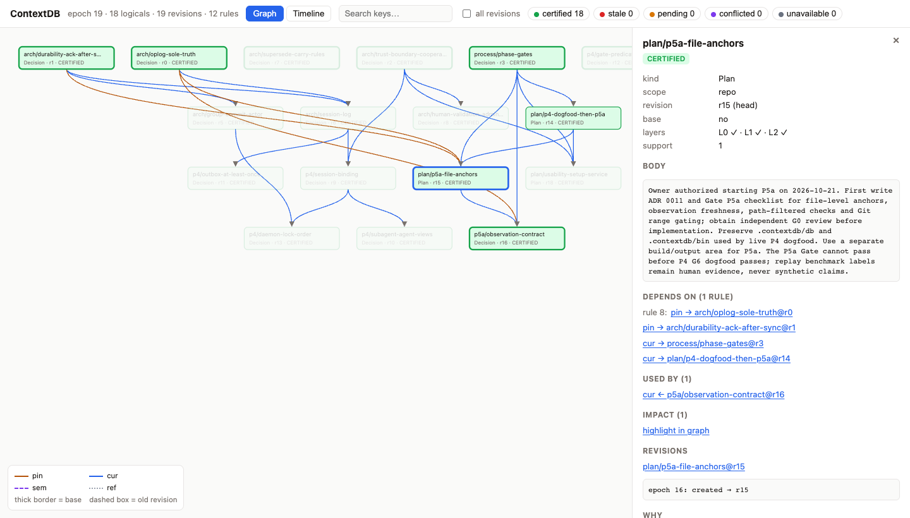

# ContextDB

[English](README.md) | **简体中文**

**多个 AI coding agent 共用的、带失效证明的上下文数据库。**

当几个 agent（Claude Code、Codex、它们的 subagent）在同一个仓库里并行工作时，它们依赖的决策、约定和计划会不断变化。ContextDB 把这些上下文和它们之间的依赖存成一张 AND/OR justification DAG：上游被替换、撤回，或者被引用的代码变了，下游会被**精确**标记为 STALE 或 PENDING，而仍有其他支持的结论不受影响。agent 在写文件、执行命令之前，用一张 certificate 校验自己读过的上下文是否仍然有效。

- **权威规范**：[`SPEC.md`](SPEC.md)（v1.6.4，唯一具规范性的文档，中文为主）
- **当前状态**：P0–P3 已通过；P4 与 P5a 已实现，正在走 Gate（见 [阶段与状态](#阶段与状态)）
- **语言与许可**：Rust 1.95.0，Apache-2.0

## 为什么需要它

设想三个 agent 并行：A 采纳决策 `D1 = MongoDB`；B 基于它写 schema 计划 `D2`；C 基于它写部署计划 `D3`。随后有人把 `D1` 改成 PostgreSQL。

只更新"最新事实"的记忆系统不能阻止 B 和 C 继续执行基于 MongoDB 的计划。ContextDB 要回答的是：

- **现在采纳的是什么？**（CURRENT）
- **哪些下游失去了支持，哪些仍有替代支持？**（IMPACT / WHY / WHY_NOT）
- **哪些只需语义复核（PENDING），而不是直接判为失效？**
- **agent 动手之前，它读过的上下文还是当前的吗？**（certificate + action gate）
- **代码改了某个决策引用的文件，依赖它的结论怎么办？**（code anchors）

在被核验的 18 个开源 agent memory 项目中，依赖驱动的**传递**失效、AND/OR 替代支持、行动前的 certified read，以及把代码作为版本化前提纳入同一传播图，都不存在（SPEC §1.3）。ContextDB 的主张不是概念首创——TMS、counting maintenance、行动前验证都有先例——而是把这些机制在一个内核中**正确组合**并可测量。

## 核心概念

| 概念 | 含义 |
|---|---|
| **logical / revision** | 一条记录（决策、计划、约定、证据、代码锚点）是一个 logical；每次修改产生不可变的 revision，logical 的 head 只能用 CAS 移动 |
| **justification** | 规则"这些前提共同支持这个结论"。一个结论可以有多条规则（OR），每条规则要求全部前提（AND）；丢掉一条支持时，有替代支持的结论保持成立 |
| **四种依赖边** | `Pin`：依赖某个确定版本，版本被替换即 STALE；`Cur`：依赖当前版本，head 一动就 STALE；`Sem`：语义依赖，新版本出现时进入 PENDING 等待复核；`Ref`：仅引用，不传播 |
| **状态** | `CERTIFIED`（结构与语义都成立）、`STALE`（失去支持，附原因）、`PENDING`（等待语义复核或观测追上）、`CONFLICTED`、`UNAVAILABLE` |
| **certificate** | agent 读到的条目及其版本的签名集合。行动前校验它：仍然有效、可重新认证，或者给出哪些读取已经过时 |
| **code anchor** | 仓库中的文件作为一等记录，revision 是工作树原始字节的 Git blob OID。文件一改，依赖它的决策按边的类型变成 STALE 或 PENDING |

完整语义（SD1–SD19、Kind 准入矩阵、STALE 原因优先级）见 SPEC §2；[`docs/SEMANTICS.md`](docs/SEMANTICS.md) 给出逐条到测试的映射。

## 架构

[docs/ARCHITECTURE.md](docs/ARCHITECTURE.md) 用图说明进程与通道、crate、`ctxd` 内的一次写入、数据目录、内核、三种 harness 的 hook 门控，以及代码锚点。

```
 Claude Code / Codex (+ subagents)
   │  MCP (ctx-mcp, stdio)          │  hooks (ctx-hook): SessionStart, PreToolUse,
   │  ctx_recall / ctx_read /       │  PostToolUse, Stop ... → 本地 outbox
   │  ctx_record / ctx_check ...    │
   ▼                                ▼
 ┌──────────────────── ctxd（每个数据目录一个）────────────────────┐
 │  agent.sock / observer.sock / admin.sock（channel 由 socket 决定） │
 │  group commit actor → 增量 counting 内核（contextdb-core）         │
 │  会话、读取账本、certificate（session log）                       │
 │  代码锚点的实时采样（contextdb-anchors）                          │
 └───────────────────────────────┬──────────────────────────────────┘
                                 ▼
   <data dir>/log/      自有 append-only op_log，blake3 hash 链：唯一真相源
   <data dir>/blobs/    自校验的 payload pack
   SQLite               可重建的投影与 FTS 检索
 git hooks / ctx anchors watch ──observer.sock──▶ 锚点变化 + watermark（CAS）
```

- **op_log 是唯一真相源**：内核状态全部由日志重放得到；SQLite 只是可重建的投影。帧落盘并 sync 之后才发布和返回。
- **单写者守护进程**：一个 commit actor 做 group commit；读者拿到 epoch 固定的快照，看不到写到一半的事务。
- **双 oracle**：独立实现的 InputModel 与 Jacobi / Kahn 求值器，用来逐事务对照增量内核（`paranoid` 构建与属性测试）。

| crate | 作用 |
|---|---|
| `contextdb-model` | 无依赖的事务契约词汇：ID、14 种 Op、wire 编码 |
| `contextdb-core` | 增量 counting 内核：support / witness / 三层认证、CURRENT、WHY、IMPACT、DIFF、certificate |
| `contextdb-oracle` | 独立的参考实现，只用于验证 |
| `contextdb-store` | op_log、blob、快照、恢复、SQLite 投影、session log |
| `contextdb-daemon` | `ctxd`：单写者守护进程、快照发布、本地 IPC、会话与门控 |
| `contextdb-proto` | IPC 协议、lease 发现、阻塞客户端、门控谓词、hook outbox |
| `contextdb-mcp` | `ctx-mcp`：MCP stdio 客户端 |
| `contextdb-hooks` | `ctx-hook`：Claude Code / Codex hook 适配 |
| `contextdb-anchors` | 文件锚点 observer：Git OID 捕获、分类、提交 |
| `contextdb-cli` | `ctx`：运维、检查、锚点、门控与 hook 安装 |
| `contextdb-testkit` / `-harness` / `-workload` / `-bench` | golden、属性测试、回放、负载生成与基准 |

另有独立 workspace：`crates/contextdb-dd`（研究基线，不进入产品依赖图）与 `fuzz/`。`ctx ui` 提供本地只读的上下文图浏览器：按分支查看（有多个分支时可切换），显示 `ref` 依赖、未解决的 Conflict artifact、按路径与 symbol 标注的代码锚点及其描述符、结构化的 WHY / WHY-NOT，并在重放状态旁给出 `ctxd` 的实时状态。



*`ctx ui` 展示本仓库自己的 dogfood 数据：决策与计划及其 `pin` / `cur` 依赖；右侧面板显示所选计划的正文、它依赖的规则、依赖它的记录以及 L0/L1/L2 认证状态。*

## 快速开始

```sh
# 1. 安装 ctx、ctxd、ctx-mcp、ctx-hook（macOS arm64 / x86_64、Linux x86_64 / arm64 的 release 构建）
curl -fsSL https://raw.githubusercontent.com/zangjiucheng/ContextDB/main/install.sh | bash
#    装到 ~/.local/bin，并按 checksums.txt 校验 SHA-256；可加 -s -- --version vX.Y.Z / --dir DIR / --setup
#    已登录 gh 时脚本用 gh 下载；也可以 clone 后运行 bash install.sh
#    从源码安装（需要 Rust 1.95.0）：scripts/install.sh，装到 ~/.cargo/bin

# 2. 在要使用的仓库里一键接入
cd /path/to/repo
ctx setup                          # 默认同时接入 Claude Code 和 Codex；--harness claude|codex|opencode 只接一个，all 接入三个

# 3. 可选：让 ctxd 开机自启、崩溃后自动重启
ctx service install .contextdb/db  # macOS 用 launchd，Linux 用 systemd --user
```

`ctx setup` 会：

- 创建数据目录（默认 `<repo>/.contextdb/db`），并加入 `.git/info/exclude`；
- 启动 `ctxd`（若已有一个协议版本不同的 `ctxd` 在服务该目录，则报错并且不做任何改动）；
- 在项目级注册 MCP 服务器 `contextdb`：Claude Code 写 `.mcp.json`，Codex 写 `.codex/config.toml`，其他配置原样保留；
- 为每个 harness 安装 hooks（`.claude/settings.local.json`、`.codex/hooks.json`、OpenCode 插件 `.opencode/plugins/contextdb/`），默认门控模式为 `warn`；OpenCode 的 MCP 服务写入 `opencode.json`；
- 它写入的文件含本机绝对路径，因此不进 Git：未跟踪的加入 `.git/info/exclude`，已被跟踪的（如团队共享的 `.mcp.json`）给出警告。要共享门控与 policy，提交 `.contextdb/gating.toml` 和 `.contextdb/policy.toml`。

之后按提示操作：Claude Code 下次启动时批准项目 MCP 服务器；Codex 中打开 `/hooks` 信任新 hook。重复运行 `ctx setup` 是幂等的；`ctx service status <dir>` 查看服务与 `ctxd` 状态，`ctx service uninstall <dir>` 移除服务（`ctx shutdown` 主动停止后服务不会再拉起）。

接入后，agent 用 `ctx_recall` / `ctx_read`（certified 模式）读取它依赖的决策，用 `ctx_record`（带 `deps`）记录决策与计划。PreToolUse 发现读过的上下文已过时会附上说明而不拦截；确认误报率足够低后再改为 `enforce`（见下文 P4 一节）。其他常用操作：

```sh
ctx anchors add .contextdb/db . src/main.rs docs/design.md   # 把关键文件注册为代码锚点
ctx status .contextdb/db                                      # 记录与会话数
ctx ui .contextdb/db                                          # 只读上下文图浏览器，http://127.0.0.1:7787/
```

**升级**：重新运行安装命令，然后 `ctx service restart <dir>`（或 `ctx shutdown <dir>` 后再 `ctx setup`）。`ctxd`、`ctx-mcp` 与 `ctx-hook` 必须来自同一构建，协议版本不同会被明确拒绝。**卸载**：在各仓库运行 `ctx service uninstall <dir>` 与 `ctx hooks uninstall --harness … --project …`，再 `bash install.sh --uninstall`。

**发布**：推送 `v*` 标签后，`.github/workflows/release.yml` 构建四个平台的 `contextdb-<os>-<arch>.tar.gz` 与 `checksums.txt` 并发布 release；hosted Actions 不可用时，`scripts/release.sh <tag>` 在本机构建 macOS 两个架构、在远程主机构建 Linux x86_64 后用 `gh` 发布。

## 阶段与状态

每个阶段必须通过 Verification Gate（G0 规范、G1 构建、G2 golden、G3 oracle / 属性 / mutation、G4 鲁棒性、G5 性能、G6 场景 / 真实使用、G7 回归、G8 文档，加独立复核）才能进入下一阶段（SPEC §4）。

| 阶段 | 内容 | 状态 |
|---|---|---|
| P0 | 形式契约与 oracle | ✅ 通过 |
| P1 | 增量 counting 内核 | ✅ 通过 |
| P2 | 持久化与恢复 | ✅ 通过 |
| P3 | 守护进程、MCP 与 certified read | ✅ 通过 |
| P4 | Hooks 与 action gating | 🟡 已实现；除 ≥ 2 周真实使用的 dogfood 外全部通过（报告最早 2026-11-04） |
| P5a | 文件级 code anchors | 🟡 已实现；除依赖 P4 外全部通过 |
| P5b | symbol 级 code anchors | 计划中 |
| P6 | 版本化事务、branch 与 WHAT_IF | 计划中 |
| P7 | 语义验证与冲突 | 计划中 |
| P8 | 检索、打包与 git 镜像 | 计划中 |
| P9 | 主体、权限与安全（硬隔离、crypto-shred） | 计划中 |
| P10 | eager / lazy 混合维护与规模 | 计划中 |
| P11 | 递归支持与复制（研究性） | 计划中 |

逐项证据见 [`docs/IMPLEMENTATION_STATUS.md`](docs/IMPLEMENTATION_STATUS.md) 与 [`docs/gates/`](docs/gates/)。

## 使用参考

### 内核（P0–P1）

Rust API 提供 `Db<Counting, NoStats>` / `Db<FullRecompute, CommitStats>`、原子事务、CURRENT、WHY / WHY_NOT、Reachable / Exact IMPACT、跨 epoch DIFF 和确定性 digest。Counting 增量维护 L0 以及计数器形式的 L1/L2（ADR 0008 §7）；`paranoid` 在提交后与独立 oracle 全量交叉检查。

- 不可变 revision 和 logical head，强制 CAS
- 正向、无环的 AND/OR justification，精确增量 set support / unsat / witness，Pearce–Kelly 动态拓扑与 NaiveTopo 参考
- 结构支持和语义 PENDING 互相独立
- **Pin-strict**：`Pin` 指向已被替换的 revision（Evidence 除外）时判为 STALE。需要历史引用就用 Evidence 或 `Ref`，需要跟随新版本就用 `Rebind` 或 `Sem`
- 事务原子发布，瞬态对读者不可见
- Certificate 签发与校验：L2 witness 闭包、strict 模式的 `since_epoch` 窗口、op_log 链接校验与重新认证（`ValidRecertified`）

```sh
cargo run --locked -p contextdb-core --example basic
```

示例建立 source → derived 规则，撤回 source 后断言两节点翻转和 derived STALE。

### 持久化（P2）

- **真相源**：`<dir>/log/` 中的自有 append-only 分段日志，一帧对应一个完整的已提交 batch，按 blake3 hash 链接。SQLite 只保存可重建的投影（`diff_log`、`head_history`、`base_history`）。
- **何时 ack**：帧写入并 sync 之后才发布和返回。macOS 默认用 F_FULLFSYNC（`StdDisk { full_sync: true }`）；关闭 fullfsync 的模式只用于测量。sync 或写入失败即 fail-stop，store 被 poison，只能在新进程中重新打开恢复。
- **崩溃后**：恢复到已 ack 前缀（I5）。最后一帧不完整时截断并在 open report 中报告（`--strict-tail` 则拒绝打开）；更早的帧损坏时拒绝打开，只能用 `ctx doctor --truncate-before` 显式修复，修复前会列出将丢失的 epoch 和 client_txn_id。
- **幂等**：带 `client_txn_id` 的重试返回原始结果；`txn_status` 返回 `Committed{epoch}` 或 `NotCommitted`。store 被 poison 后拒绝一切读取和 `txn_status`，in-flight 事务的结果要重启后才能确定。
- **运维工具**：`ctx` 不会创建 store，路径写错会报 `NotAStore`。`doctor --truncate-before` 和 `migrate` 持有同一把目录锁。迁移中断时 open 拒绝打开（`MigrationIncomplete`），再次运行 `ctx migrate` 即可完成迁移。
- **不支持**：P9 之前不支持 erasure，不会删除 blob；没有签名 head，hash 链能检测损坏，但不能防止整体重写。

```sh
ctx replay <dir>        # 打开、重放并打印 open report
ctx doctor <dir>        # hash 链、全量 oracle 校验、blob 检查；--rebuild 重建投影
ctx snapshot <dir>      # 写输入层快照，加速冷启动
ctx migrate <dir>       # 迁移旧格式 op_log（保留备份）
ctx export <dir>        # 导出为 EventLog v0 JSONL
```

### 守护进程与 MCP（P3）

- **`ctxd <dir>`**：每个数据目录对应一个守护进程，只有它写 op_log。第二个实例由目录锁和 lease 拒绝（T37）。网络与虚拟文件系统默认拒绝，`--allow-fs <name>` 可显式放行。
- **提交**：写请求由单一 commit actor 合成一组提交（group commit），每组只 sync 一次 op_log，所有回复都等这次 sync 完成后才发出。payload 追加到自校验的 blob pack，用 ordered sync 保证它们先于引用它们的帧落盘（ADR 0008 §17）。
- **读取**：读者拿到 epoch 固定的快照，不会看到写到一半的组（I4）。快照通过两个副本交替发布，被回收的副本只有在没有读者持有时才会复用（loom 模型检查）。
- **三个 socket**：`<dir>/run/agent.sock`、`observer.sock`、`admin.sock`（路径过长时放到临时目录），权限 0600，并检查 peer uid。连接的 socket 决定 channel，请求参数不能伪造身份。受控语义验证（`ctx validate`，可由授权维护 agent 执行）、`shutdown` 只能走 admin；原始 batch 不能走 agent。
- **信任边界**：P3 只承诺协作式边界。能以同一 OS 用户执行 shell 的恶意 agent 仍可连接 observer/admin socket；硬隔离要等 P9 的 principal 与 ACL。
- **会话**：会话、读取账本和证书写在独立的 session log（`<dir>/sessions/`），与 op_log 一样分组、hash 链接，守护进程重启后会话仍然有效。读取事件最多延迟 100 ms 落盘，`SessionStart`、`CertIssued`、`SessionEnd` 立即 sync。
- **超时与过载**：写队列满时返回 `Busy`。请求超过 30 s 返回 `Timeout`，超时的写仍可能提交，用 `client_txn_id` 查 `ctx_txn_status` 即可确定结果。

**MCP**：`ctx-mcp <dir>` 通过 stdio 提供 JSON-RPC 2.0（每行一条消息），从 `<dir>/ctxd.lease` 找到 agent socket。

| 工具 | 作用 |
|---|---|
| `ctx_recall` | 按 key / 正文检索（FTS5）；certified 模式只返回 CERTIFIED 条目，并给出可作 dep 的 handle（`<12 hex>.<idx>`） |
| `ctx_read` | 读一条记录；certified 模式下当前 head 不是 CERTIFIED 就失败 |
| `ctx_record` | 新建（`create_only` + `key`）或按 CAS 修订（`expected_head = key@rev`），deps 用 handle 或 `key@rev` |
| `ctx_supersede` | 替换 head；`carry_rules=copy` 只复制旧 head 自己的 justification，下游规则从不自动改绑 |
| `ctx_why` / `ctx_why_not` / `ctx_impact` | 解释成立 / 不成立的原因，列出依赖它的记录 |
| `ctx_check` | 校验本会话（本 agent 视图）的证书，给出判定、diff 和自上次确认以来变化的读取（`context_update`，只 peek 不消费）；可带 `action{tool, paths, command}` |
| `ctx_txn_status` | 按 `client_txn_id` 查询 `Committed{epoch}` 或 `NotCommitted` |

P3 不向 agent 提供 `ctx_validate`。

**运维命令**（`ctxd` 运行时经 admin socket；离线命令在守护进程运行期间会被 `Locked` 拒绝）：

```sh
ctxd <dir> [--allow-fs <name>]   # 启动守护进程
ctx status <dir>                 # revision / logical / 会话数
ctx why|why-not|impact <dir> <key[@rev]>
ctx diff <dir> <from> <to>
ctx validate <dir> <key@rev> verified|rejected [--yes]
                                 # 受控验证：先列出当前语义向量；自动流程可用 --yes，仍只走 admin 与 curvec CAS
ctx shutdown <dir>
```

### Hooks 与 action gating（P4）

`ctx-hook <claude|codex> <event>` 是 Claude Code（2.1.306）与 Codex CLI（0.163.0）的 hook 命令：从 stdin 读一个 hook 事件，最多输出一个 JSON 对象，总是以 0 退出（ADR 0010）。

- **安装**：`ctx hooks install --harness claude|codex --project <repo> --dir <data dir>` 把 hook 合并进 `.claude/settings.json` 或 `.codex/hooks.json`，保留已有的其他 hook；重复安装不变，`uninstall` 只删除 ContextDB 的条目。**Codex 只在你信任新 hook 后才运行它们**（Codex 中打开 `/hooks`，或在启动审查时确认），之后每次修改都要重新信任。
- **OpenCode 2.0**：没有 hook 命令，只有插件。`ctx hooks install --harness opencode` 生成一个插件，它把每个事件以同样的 stdin 交给 `ctx-hook opencode <event>`，再把结果映射回去：deny 让工具调用失败，警告附在工具输出之后，briefing 与本轮上下文进入 system prompt。OpenCode 的 MCP 调用自带会话 id，不需要 claim；子 agent 的子会话是独立的 ContextDB 会话（ADR 0014）。
- **会话绑定**：每个 hook 事件按 harness 的 `session_id` 绑定到一个 ctxd 会话。MCP 调用按 harness 在 `_meta` 中给出的 tool-call id 绑定：Codex 直接带 `sessionId` / `threadId`；Claude Code 由 PreToolUse hook 先 claim `tool_use_id`。没有 id 的调用使用 `ctx-mcp` 自己的会话并标记 `unclaimed`，从不按内容猜测。
- **Subagent**：子 agent 与根共用会话，按 agent 分视图：子 agent 继承根的读取；子 agent 的读取进入根的视图；根自己读过的 logical 以根的条目为准。
- **PreToolUse**：Edit / Write / MultiEdit / NotebookEdit / Bash（Claude）与 `apply_patch` / Bash（Codex）在执行前校验本会话证书。`warn` 模式加一段上下文说明哪些读取变了；`enforce` 模式对 Invalid / Conflicted / Denied / Ambiguous 拒绝，理由不超过 480 字节；放行时不输出（不会绕过 harness 自己的权限提示）。没有任何 certified 读取（`Empty`）永远不算通过，只警告（每 10 分钟最多提示一次，但每次都记录）。
- **门控配置**：`.contextdb/gating.toml`（`mode = off|warn|enforce`、`shell_mode`、`on_unavailable = open|closed`、`timeout_ms`、按 tool / 路径 glob 的 `[[rule]]`），用 `ctx gating apply <dir>` 编译后生效。默认 `warn`、fail-open、150 ms。daemon 不可达、超时或输入无法解析时，open 只提示、closed 则拒绝；不是 ContextDB 仓库时什么都不做。
- **context_update**：UserPromptSubmit 把自上次确认以来变化的读取以 `<context_update epoch=…>` 追加到新 prompt，不改写已有前缀（保 prompt cache）；下一次 prompt 才确认，输出丢失会重发。
- **Outbox 与 drift**：PostToolUse 把写入事实先写入本地 outbox（`<data dir>/outbox/`，自校验记录、每流单调 seq），再投递；daemon 按 `(stream, seq)` 幂等应用，ctxd 启动时及每 30 s 补投遗留的流。Stop / SubagentStop / PreCompact 对比 git 的实际变化与记录的编辑，用 `systemMessage` 报告“没有记录就被改的文件”（如经 Bash 的副作用）。drift 只报告不门控，且是上界：人或没装 hook 的 agent 的修改也会出现在里面。
- **Policy**：`.contextdb/policy.toml`（如 `version = 1`、`require_deps = ["Decision", "Plan"]`）由 `ctx policy apply <dir>` 经 admin 提交；它在内核事务中执行，任何通道都绕不过，与 hook 是否安装、git `--no-verify` 无关。
- **记录内容**：行动事实（含完整 Bash 命令）写入 session log 用于 drift 与 dogfood 报告；命令里若含密钥，也会被记录。
- **剩余窗口（TOCTOU）**：PreToolUse 校验与真正写文件之间仍有时间窗口；它缩小但不消除风险。Bash 的副作用无法在执行前按路径解析，只能事后由 drift 发现。信任边界仍是协作式的：agent 可以卸载 hook 或直连 admin socket（P9 才有硬隔离）。

```sh
ctx check <dir> --harness claude --key <session_id> [--strict] [--dry-run --action-tool edit --action-path src/a.rs]
                                 # 退出码：0 放行（warn 也是 0，除非 --fail-on-warn）、1 拒绝、2 错误、3 daemon 不可达
ctx check <dir> --all            # 任何 head 为 STALE / CONFLICTED 时退出 1（可选，默认不安装）
ctx hooks flush <dir>            # 立即投递所有遗留 outbox 事实
ctx gate-report P4 <dir> [--out docs/gates/p4-dogfood.md]
ctx dogfood review <dir>         # agent 复核 warn/deny 与抽样放行，供 false-deny 率使用
```

**升级说明**：P4 把 IPC 协议升到版本 2，P3 的 `ctx-mcp` 进程会收到 `ProtocolVersion` 错误，harness 重启它后恢复。P4 的 session log 增加了新事件，P3 二进制无法打开（不支持降级）；P3 的 session log 在 P4 下照常重放。

### 文件级代码锚点（P5a）

把仓库里的文件注册为 `CodeAnchor`，决策和计划可以像依赖其他记录一样依赖它们；文件内容一变，下游按依赖类型变成 STALE 或 PENDING（ADR 0011）。

- **身份**：锚点 revision 是工作树**原始字节**的 Git blob OID（等同 `git hash-object --no-filters`，支持 SHA-1 / SHA-256 仓库），不经过 clean / EOL filter。内容相同就复用同一 RevisionId，所以删除后原样恢复，下游也会恢复。key 为 `code:<repo-id>/<相对路径>`，只接受小写 ASCII 路径；`..`、`.git`、symlink（包括父目录）、子模块、运行时数据目录都拒绝或判为 Broken。
- **observer**：`ctx anchors scan|watch` 两次完整采样 HEAD 与所有注册文件，结果一致才在一个 batch 里提交内容变化与 `ObserverWatermark`（CAS，冲突时重新采样）。文件删除 → `RetractBase` + `AnchorBroken`；恢复 → 重新断言 base。
- **freshness**：每次 certified 读取、recall 和 check，daemon 都按可信路由（`<data dir>/anchors.routes`，由 `ctx anchors add` 写入）实时采样一次；实时位置与 watermark 不一致、采样失败、超出上限（1,000 锚点 / scope、16 MiB / 文件、40 ms）、路由缺失或描述符损坏、采样期间有新的编辑通知（hook 追加编辑事实前先更新 `outbox/announce`，daemon 在采样前后各读一次）、该记录缺失或损坏、通告失败（`ctx anchors repair-announce <dir>` 修复）或数据目录没有 `announce-v1` 标记（`ctx hooks install --dir` 写入；同一数据目录的所有 harness 都要用 P5a 的 hook 重装），一律是 `PENDING(ObservationLag)` / 证书 `Unknown`，从不当作新鲜。
- **按路径过滤**：Edit / Write / apply_patch 的 PreToolUse 只检查 support 闭包涉及目标路径的 required 读取（Sem 同时看断言的 premise 与当前 head，不跟 Ref）；未锚定的读取、Bash、未知或别名不确定的路径（大小写别名、硬链接、symlink）都回退为全量检查。每个 root 首次认证时的证明会持久化，过滤检查沿用原来的 strict 窗口。
- **Git hooks 与 pre-push**：`hooks install` 为 post-commit / post-checkout / post-merge 加上一次扫描，保留并先运行原有 hook（备份为 `<hook>.contextdb-original`）；`--pre-push` 才安装硬门控。pre-push 处理所有 ref pair：被推送的提交必须就是当前 HEAD，且所有注册文件的原始字节与该提交一致，否则为 Unknown 并拒绝。

```sh
ctx anchors add <dir> <repo> <path>...   # 注册（并写入可信路由），随即扫描一次
ctx anchors scan|watch|status <dir> <repo>
ctx anchors hooks <dir> <repo> install [--pre-push] | uninstall
ctx check <dir> --strict --range <a>..<b> [--repo <repo>]
                                 # 点时检查：从 a..b 改动的已注册文件出发，覆盖所有可达的当前 head（不限会话读集），
                                 # 新签发证书、strict 窗口从此刻开始；不声明整个 Git 范围内没有历史 ABA。非 Valid 退出 1
```

**升级说明**：P5a 把 IPC 协议升到 3，并写 format-2 的 session log 段（写第一个新事件前强制从 format-1 段切换）。P4 的 session log 在 P5a 下照常读取；P4 二进制会在截断前拒绝 format-2 段，不支持降级。P4 dogfood 期间不要用 P5a 构建覆盖 `.contextdb/bin`。

## 边界与非目标

- **版本一致不等于语义正确**：ContextDB 证明"在声明的依赖版本与验证规则下可以使用"，不判断自然语言内容是否正确。
- **信任边界是协作式的**：能以同一 OS 用户执行 shell 的 agent 可以卸载 hook 或直连 admin socket；硬隔离、多主体权限与 right-to-erasure 在 P9。
- **当前不支持**：环形依赖（成环写入被拒绝，P11 再研究）；否定、默认逻辑、非单调规则；valid time / bitemporal 查询（只建模 transaction time）；跨机复制；symbol 级锚点（P5b）。
- **TOCTOU**：行动前校验与真正写文件之间仍有窗口；Bash 的副作用只能事后由 drift 发现。

## 开发与验证

需要 Rust 1.95.0 和 Python 3.11+。首次安装检查工具：

```sh
cargo install cargo-deny --version 0.20.2 --locked
```

与 CI 相同的基础检查（fmt、Clippy、全部测试、loom 模型、依赖边界、许可证）：

```sh
bash scripts/check.sh
```

更重的验证：

```sh
cargo test --release --locked -p contextdb-testkit --test exhaustive -- --ignored --nocapture   # 有限状态穷举
bash scripts/gate-regression.sh     # 前序阶段的 G2/G3/G4 按 gate 计数回归
bash scripts/mutation.sh            # cargo-mutants（另有 mutation-p4.sh、mutation-p5a.sh）
bash scripts/fuzz.sh                # cargo-fuzz 目标
bash scripts/remote.sh run <name> <cmd...>   # 在远程 Linux 主机上运行长任务
```

**流程**：每个阶段先写 ADR 并经独立复核（G0），实现后逐层收集证据，由不参与实现的复核者做反例审查，结论记入 `docs/gates/<阶段>.md`。项目采用 agent 自主执行流程（SPEC §4.4）：标注、独立复核、dogfood 维护与阶段报告由 agent 完成，不要求人工参与；标注保留来源、理由与证据哈希，历史人工判断只作可选对照；真实使用时长、确定性 oracle、性能预算与失败状态仍逐项验证。

## 文档地图

| 路径 | 内容 |
|---|---|
| [`SPEC.md`](SPEC.md) | 权威规范：语义、架构、验证体系、阶段计划、接口、测试目录、威胁模型 |
| [`docs/adr/`](docs/adr/) | 每个阶段的设计决策记录（ADR 0001–0011） |
| [`docs/gates/`](docs/gates/) | 各阶段的 Gate 证据、复核记录与基准结果 |
| [`docs/IMPLEMENTATION_STATUS.md`](docs/IMPLEMENTATION_STATUS.md) | 当前实现与 Gate 状态 |
| [`docs/SEMANTICS.md`](docs/SEMANTICS.md) | 语义条款到测试的映射 |
| [`CHANGELOG.md`](CHANGELOG.md) | 变更记录 |
| [`docs/research/`](docs/research/) | 研究归档（不具规范性） |

研究原型与 `crates/contextdb-dd` 已从主 workspace 排除，R2 的 workspace 独立保留；归档的 DBSP 原型需要研究 README 所述补丁源码，主项目构建不依赖它。

许可证：Apache-2.0，见 [`LICENSE`](LICENSE)。
