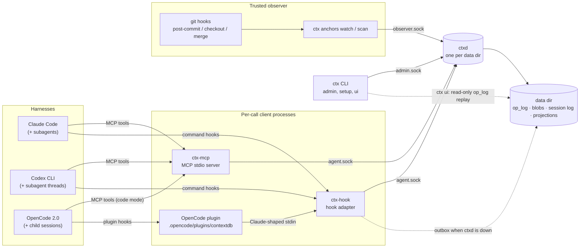
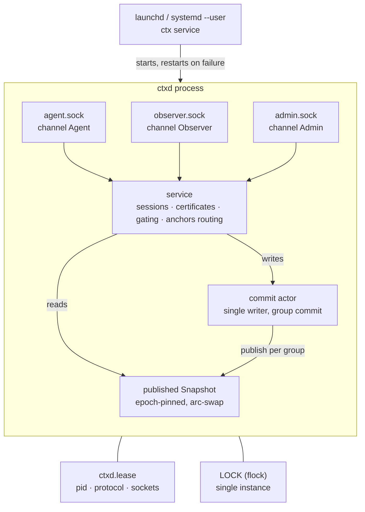
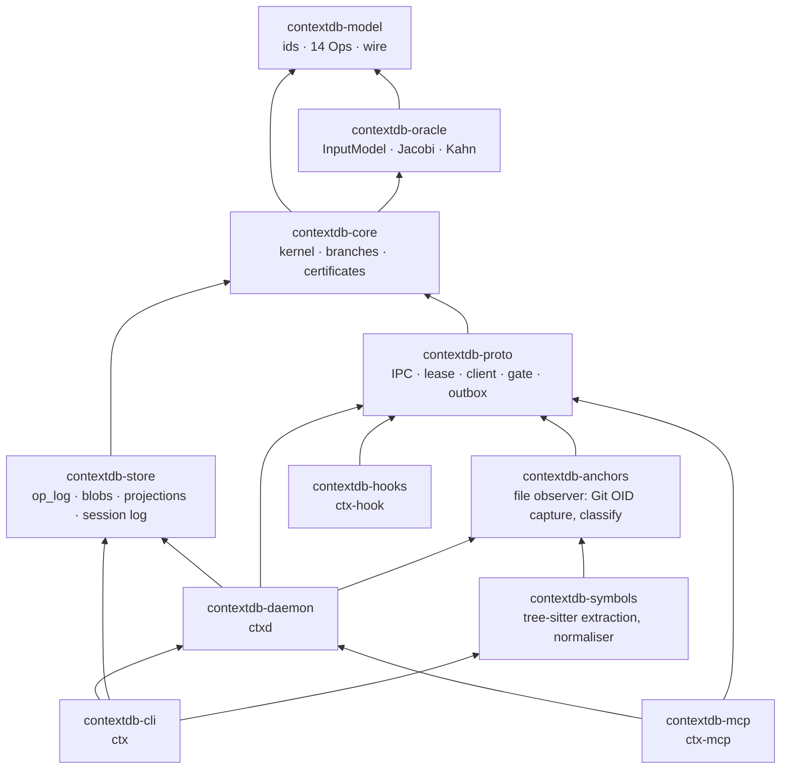
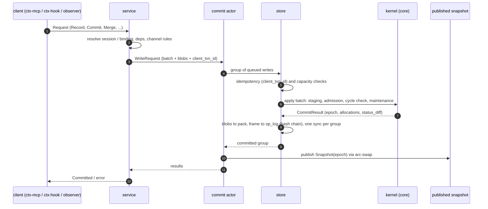
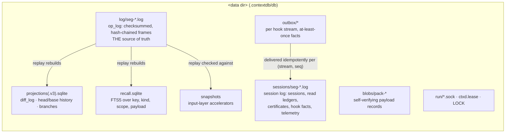
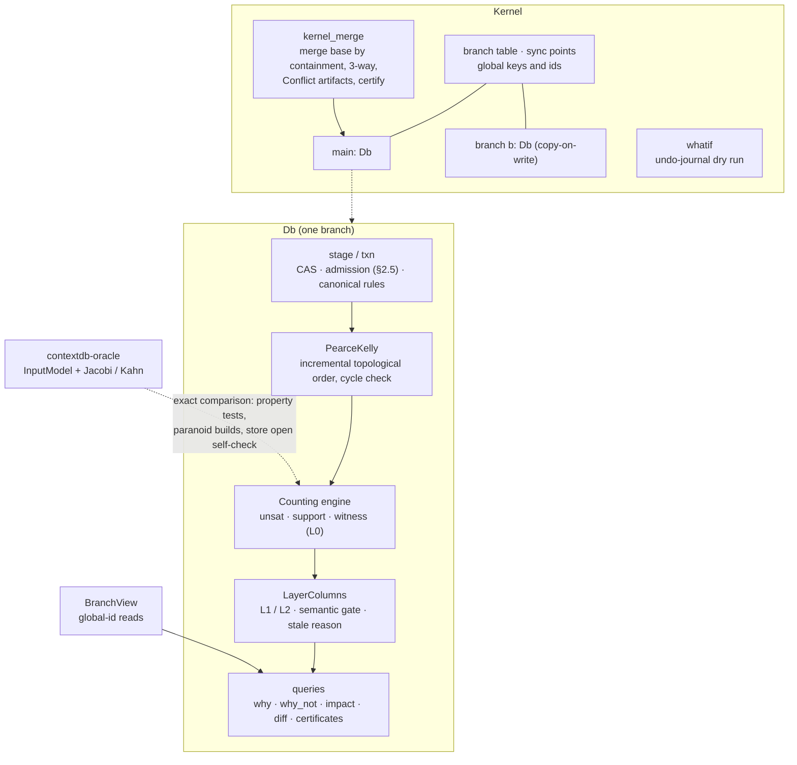
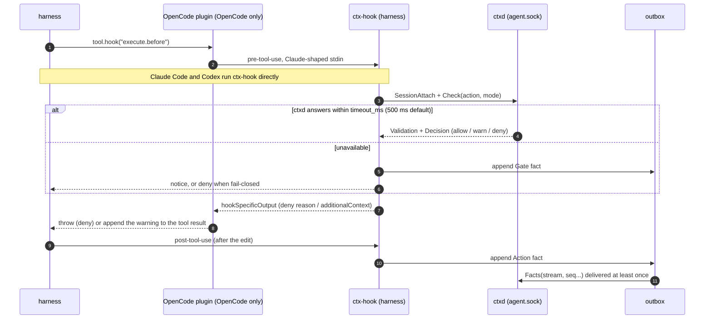
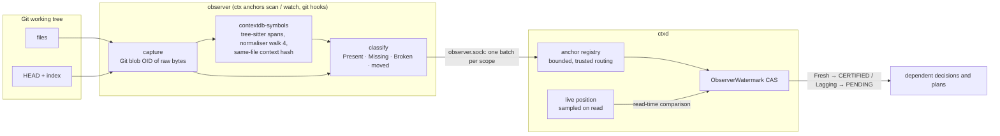

# Architecture

This page shows how ContextDB's processes, crates and files fit together.
The normative semantics are in [SPEC.md](../SPEC.md). Each design decision
has an ADR under [docs/adr/](adr/), cited below as "ADR nnnn".

## 1. System context

Agents work through their harness. A harness reaches ContextDB through two
paths:

- **MCP tools** (`ctx-mcp`), to read and write context;
- **hooks** (`ctx-hook`), so that edits are checked and recorded without the
  agent having to ask.

A trusted observer reports code changes. One `ctxd` per data directory is
the only writer.

## 2. Processes, sockets and channels

The socket a request arrives on decides its **channel**; the request never
claims an identity. Each channel may submit only its own kinds of writes
(SPEC §2.5 A7, ADR 0008 §2):

- only the observer channel writes code anchors and watermarks;
- only the admin channel records human validations and policy.

- **Discovery.** Clients find `ctxd` through `ctxd.lease` and refuse a
  protocol mismatch; all four binaries ship from one build.
- **Service.** `ctx setup` installs the per-repository login service. A
  `ctxd` started by hand is left alone.

## 3. Crates

Product crates, with arrows pointing at dependencies. `contextdb-model` is
the dependency-free vocabulary (ids, the Ops, wire encoding).
`contextdb-oracle` is an independent reference implementation that core
uses only for its paranoid self-checks.

Two splits are deliberate:

- **`ctxd` never links `contextdb-symbols`.** The daemon's live path never
  parses source (ADR 0012); symbol hashing happens in the observer.
- **`ctx-hook` links only `proto` and `model`.** It stays small and fast:
  it runs on every tool call.

Verification crates (`testkit`, `harness`, `workload`, `bench`) and the
separate `contextdb-dd` research workspace are left out.

## 4. Inside ctxd: one write

Writes go through a single actor. It commits queued writes as a group:

1. append every batch's frame to the op_log with **one** sync;
2. only then publish the new epoch's snapshot;
3. only then acknowledge.

Readers hold an epoch-pinned snapshot and never see half a group (ADR 0006,
ADR 0008 §3).

A failed sync poisons the store until a fresh process opens it, so an
acknowledged write is always durable. SQLite projections and the FTS recall
index are updated after the log. They can be rebuilt from it and are never
read past their watermark.

## 5. The data directory

- **Source of truth.** Only `log/` defines kernel state.
- **Never feeds the kernel.** The session log is a second hash-chained log
  family for agent-side records.
- **Rebuildable.** Everything in SQLite can be dropped and rebuilt
  (`ctx doctor --rebuild`).
- **Format changes.** A new op_log format is explicit: an older store is
  refused until `ctx migrate` rewrites it and keeps a backup.

## 6. The kernel

`Kernel` holds the branch table, the global key namespace and the global id
counters. Every branch is an ordinary single-branch `Db` that holds only the
objects visible in it, under local ids. Ids are mapped at the boundary
(SD19, ADR 0013).

Inside a `Db`, a batch goes through these steps:

1. it is staged;
2. it is admitted: CAS, the kind admission matrix, the rule canonical form,
   policy;
3. it is checked for cycles on an incrementally maintained topological order;
4. the derived state is maintained incrementally:
   - support counts and witnesses (L0);
   - the L1/L2 certification columns;
   - semantic gates.

- **Rules.** A rule's conclusion holds when the rule is enabled, has at
  least one premise, and every premise literal holds (SD3).
- **Reference-only rules.** A rule with only `Ref` incidences records
  references and never supports its conclusion (SPEC v1.6.11).
- **Pure state.** Derived state is a pure function of committed inputs.
- **Two independent checks.** Two oracles, plus a full-recompute engine,
  check the incremental engine exactly.

## 7. Hooks and gating

Every harness turns a tool call into the same check. The hook asks `ctxd`
to validate the session's certificate (the reads it relied on) for this
action:

- `warn` explains which reads changed;
- `enforce` denies.

Facts that must not be lost go through the outbox when `ctxd` is
unreachable (ADR 0010, ADR 0014).

- **Binding a session:**
  - hook events bind by the harness `session_id`;
  - Codex MCP calls bind by the `sessionId`/`threadId` in `_meta`;
  - OpenCode MCP calls bind by `_meta["ai.opencode/sessionID"]`;
  - Claude Code MCP calls are claimed through the tool-use id the
    PreToolUse hook saw.
- **Getting context to the agent.** The briefing (SessionStart) and the
  changed reads (UserPromptSubmit) are injected as context. OpenCode has no
  context hook, so its plugin adds them to the system prompt of every model
  request instead.

## 8. Code anchors

A code anchor makes a file, or a symbol inside a file, a record. Only the
trusted observer channel writes anchors. An observer submits its captures
and classifications for a scope as one batch, together with a CAS on the
scope's `ObserverWatermark`.

Freshness is decided at read time: the committed watermark is compared with
the live position. A lagging observer makes dependents
`PENDING(ObservationLag)`, never silently certified (SD14b, SD18,
ADR 0011/0012).

## 9. Where to read more

| Topic | Document |
|---|---|
| Semantics, gates, the phase plan | [SPEC.md](../SPEC.md), [SEMANTICS.md](SEMANTICS.md) |
| Durable log, recovery, snapshots | ADR 0006, ADR 0007 |
| Daemon, sessions, certificates | ADR 0008, ADR 0009 |
| Hooks and gating | ADR 0010; OpenCode: ADR 0014 |
| File and symbol anchors | ADR 0011, ADR 0012 |
| Branches, transactions, WHAT_IF | ADR 0013 |
| Phase status | [IMPLEMENTATION_STATUS.md](IMPLEMENTATION_STATUS.md), [gates/](gates/) |
