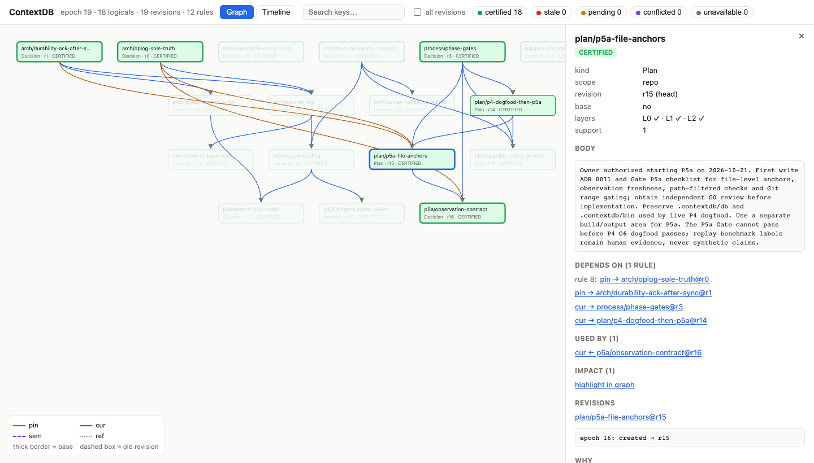

# Getting started

[README](../README.md) · **Getting started** · [Reference](REFERENCE.md) · [Development](DEVELOPMENT.md)

## Install and connect a repository

```sh
# 1. Install ctx, ctxd, ctx-mcp and ctx-hook (release builds for macOS arm64 / x86_64, Linux x86_64 / arm64)
curl -fsSL https://raw.githubusercontent.com/zangjiucheng/ContextDB/main/install.sh | bash
#    Installs into ~/.local/bin after checking the SHA-256 against checksums.txt.
#    Options: ... | bash -s -- --version vX.Y.Z --dir DIR --setup
#    Uses an authenticated gh when present; or clone and run bash install.sh.
#    From source (needs Rust 1.95.0): scripts/install.sh, into ~/.cargo/bin

# 2. Connect a repository in one step
cd /path/to/repo
ctx setup                          # Claude Code and Codex by default; --harness claude|codex|opencode for one, all for the three
```

`ctx setup`:

- creates the data directory (default `<repo>/.contextdb/db`) and adds it to `.git/info/exclude`;
- starts `ctxd` through a per-repository user service (launchd on macOS, systemd `--user` on Linux), so it starts at login and restarts after a crash. A `ctxd` that is already running is left alone. If it was started by hand, `ctx shutdown <dir>` followed by `ctx setup` hands it to the service. Without a usable service manager (an SSH session, CI), `ctxd` is started detached and setup says so. `--no-service` starts it detached on purpose; `--no-start` starts nothing. If a `ctxd` speaking another protocol version already serves the directory, setup reports an error and changes nothing;
- registers the `contextdb` MCP server per project: `.mcp.json` for Claude Code, `.codex/config.toml` for Codex, `opencode.json` for OpenCode, keeping all other configuration;
- installs the hooks for each harness (`.claude/settings.local.json`, `.codex/hooks.json`, the OpenCode plugin `.opencode/plugins/contextdb/`) with the default gating mode `warn`;
- keeps the files it writes out of Git, since they hold machine-specific paths: untracked ones are added to `.git/info/exclude`, and a tracked one (e.g. a team `.mcp.json`) gets a warning. Commit `.contextdb/gating.toml` and `.contextdb/policy.toml` to share gating and policy.

Then follow the prompts: approve the project MCP server the next time Claude Code starts, open `/hooks` in Codex to trust the new hooks, and restart OpenCode in the project so it loads the plugin. Re-running `ctx setup` is idempotent. `ctx service status <dir>` shows the service and `ctxd`; `ctx service uninstall <dir>` removes the service (after a deliberate `ctx shutdown`, the service does not restart `ctxd`).

Once connected, agents read the decisions they rely on with `ctx_recall` / `ctx_read` (certified mode) and record decisions and plans with `ctx_record` (with `deps`; a refused dep says which one and what to send instead). When PreToolUse finds that context the agent read is out of date, it adds an explanation without blocking; switch to `enforce` once the false-alarm rate is low enough (see [Hooks and action gating](REFERENCE.md#hooks-and-action-gating-p4)). Other common commands:

```sh
ctx anchors add .contextdb/db . src/main.rs docs/design.md   # register key files as code anchors
ctx status .contextdb/db                                      # record and session counts
ctx ui .contextdb/db                                          # read-only context graph viewer at http://127.0.0.1:7787/
```

**Upgrade**: run the install command again, then `ctx service restart <dir>` (or `ctx shutdown <dir>` followed by `ctx setup`). `ctxd`, `ctx-mcp` and `ctx-hook` must come from the same build; a protocol mismatch is rejected explicitly. **Uninstall**: in each repository run `ctx service uninstall <dir>` and `ctx hooks uninstall --harness … --project …`, then `bash install.sh --uninstall`.

**Releases**: pushing a `v*` tag runs `.github/workflows/release.yml`, which builds `contextdb-<os>-<arch>.tar.gz` for four platforms plus `checksums.txt` and publishes a release. When hosted Actions are unavailable, `scripts/release.sh <tag>` builds both macOS architectures locally and Linux x86_64 on the remote host, then publishes with `gh`.

## Viewing the context: `ctx ui`

`ctx ui` serves a local, read-only viewer with three tabs:
- **Records** (the default) lists every head grouped by key path, with its status, kind and stored abstract, any changed Summary premises, and the latest head moves. Search covers keys and abstracts.
- **Graph** shows the justification DAG, whole or 1–3 hops around the selected record, with `ref` edges and open Conflict artifacts.
- **Timeline** lists the commits.

It shows one branch at a time, with a selector when there are several. The header shows only the statuses that occur and says so when every head is certified. The detail panel shows the body as abstract, outline or full, code anchors by path and symbol with their decoded descriptors, structured WHY / WHY-NOT, and the live status from `ctxd` next to the replayed one.



*`ctx ui` on this repository's own dogfood data: decisions and plans with their `pin` / `cur` dependencies; the panel shows a plan's body, the rules it depends on, its dependents and its L0/L1/L2 certification.*
