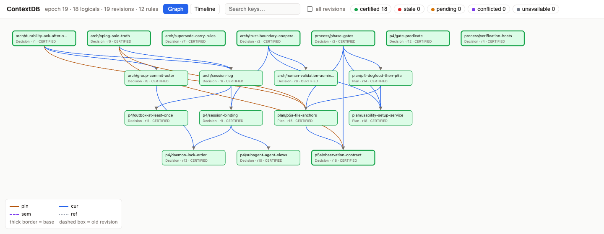

# ctx-ui



A local, read-only view of a ContextDB context graph in the browser:
- logicals and revisions, coloured by derived state (CERTIFIED / STALE / PENDING / CONFLICTED / UNAVAILABLE);
- the justification DAG, with premises above their conclusions and edges styled by kind (pin / cur / sem / ref);
- details for each record: body, rules, dependents, impact, revision history, WHY / WHY-NOT;
- a commit timeline.

```sh
cargo build --release --manifest-path tools/ctx-ui/Cargo.toml
tools/ctx-ui/target/release/ctx-ui <data dir> [--port 7787]   # then open http://127.0.0.1:7787/
```

## How it works

- **Graph:** the op_log is the only source of truth (SPEC §3.5 #7). `ctx-ui` verifies it with `contextdb_store::log::scan` and replays it into a private `Db`, so the graph is exact. It takes no store lock and writes nothing, so it runs next to a live `ctxd`; it replays again only when an op_log segment changes, and the page polls every 2 s.
- **Bodies:** payload bodies live in blob packs that only `ctxd` indexes, so they are fetched as advisory `Read`s over the agent socket, under the harness key `ctx-ui/viewer`. If the daemon is not running, or speaks another protocol version, the panel says so.
- **Security:** the server binds 127.0.0.1 only and answers GET only. It rejects any `Host` header other than `127.0.0.1:<port>` / `localhost:<port>` (DNS rebinding), and serves a strict Content-Security-Policy (no inline script, no third-party assets).
- **Build:** a separate Cargo workspace (like `fuzz/`): it builds against the product crates by path, without joining the product workspace or its dependency policy. It is not part of a phase gate.
